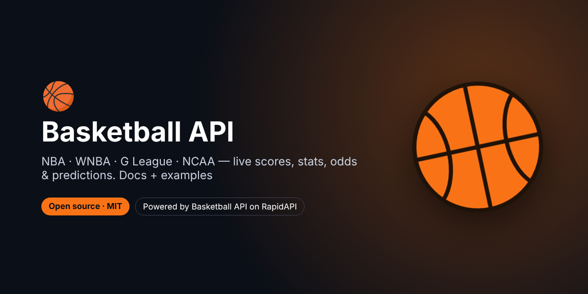

# Basketball API – NBA, WNBA, G League & NCAA (live scores, stats, odds, predictions)



[-0055DA?logo=rapidapi&logoColor=white)](https://rapidapi.com/belchiorarkad-FqvHs2EDOtP/api/api-basketball-nba)
[](https://t.me/pintoflow)


> **For faster support reply, contact us on Telegram: [@pintoflow](https://t.me/pintoflow)**

**Get the API: https://rapidapi.com/belchiorarkad-FqvHs2EDOtP/api/api-basketball-nba**

A REST API for **live basketball scores, schedules, box scores, play-by-play, shot charts, odds, standings, teams, players, injuries, news, transactions, futures and predictions** for the **NBA, WNBA, G League and NCAA (men's and women's)**.

It includes:

- 🔮 **Game predictions**: win probabilities, projected scores, spreads and totals, compared with the betting market
- 🏆 **Season and playoff simulations** (title odds)
- 📊 **Power rankings and team ratings** (Elo, net rating)
- 🎯 **Player prop projections** with over/under probabilities, plus **hit-rate trends**

This repository contains the documentation plus ready-to-run examples in **cURL**, **Node.js** and **Python**.

---

## Quick start

```bash
curl --request GET \
  --url 'https://api-basketball-nba.p.rapidapi.com/v2/games' \
  --header 'x-rapidapi-host: api-basketball-nba.p.rapidapi.com' \
  --header 'x-rapidapi-key: YOUR_RAPIDAPI_KEY'
```

| What you want | Call |
|---|---|
| Today's games | `GET /v2/games` |
| Games in progress right now | `GET /v2/games/live` |
| Predictions for today | `GET /v2/predictions` |
| Everything about one game | `GET /v2/games/{gameId}` |
| Find a player's ID | `GET /v2/players/search?q=curry` |
| A player's projection for the next game | `GET /v2/players/{playerId}/projection?lines=PTS:24.5,REB:7.5` |
| Title and playoff odds | `GET /v2/predictions/season` |

### Key concepts

- **IDs** are numeric. Game IDs come from `/v2/games`; team IDs from `/v2/teams` (e.g. `13` = Lakers); player IDs from `/v2/players/search`.
- **Seasons** use the year the season **ends**: 2025-26 = `2026`. WNBA uses the calendar year.
- **Dates** accept `YYYYMMDD` or `YYYY-MM-DD`. "Today" is today in US Eastern time.
- **Leagues:** add `league=` to any v2 endpoint: `nba` (default), `wnba`, `gleague`, `ncaam`, `ncaaw`.
- **Freshness:** live games refresh about every 10 s, odds every 30–60 s, injuries and standings every 5 min. Every v2 response includes `meta.cacheTtlSeconds`.

Every v2 response has the same shape:

```json
{ "data": { }, "meta": { "league": "nba", "generatedAt": "…", "cacheTtlSeconds": 300 } }
```

---

## Examples in this repo

| File | What it does |
|---|---|
| [`examples/curl/examples.sh`](examples/curl/examples.sh) | One cURL call for each main endpoint |
| [`examples/node/todays-predictions.mjs`](examples/node/todays-predictions.mjs) | Prints today's games with win probability, projected score and market value (Node.js 18+, no dependencies) |
| [`examples/node/prop-check.mjs`](examples/node/prop-check.mjs) | Hit rates and next-game projection for a player prop, e.g. `curry PTS 26.5` |
| [`examples/python/live_scores.py`](examples/python/live_scores.py) | Terminal live scoreboard that refreshes every 15 s |
| [`examples/python/title_odds.py`](examples/python/title_odds.py) | Championship and playoff odds from the season simulation, exported to CSV |

```bash
export RAPIDAPI_KEY=your_key_here
node examples/node/todays-predictions.mjs
node examples/node/prop-check.mjs curry PTS 26.5
python3 examples/python/live_scores.py
```

---

## v2 endpoints (recommended)

### Meta
| Endpoint | Description |
|---|---|
| `GET /v2` | List of every v2 endpoint |
| `GET /v2/health` | Service status |
| `GET /v2/leagues` | Supported leagues and their current season |
| `GET /v2/season` | Current season: dates, phase and calendar |

### Games
| Endpoint | Params | Description |
|---|---|---|
| `GET /v2/games` | `date` | All games of a day: teams, scores, quarter scores, status, venue, TV, records, leaders, odds |
| `GET /v2/games/live` | – | Games in progress right now (~10 s refresh) |
| `GET /v2/games/upcoming` | `days` (1–14, default 3) | Upcoming games, each with a prediction |
| `GET /v2/games/range` | `from`, `to` (max 31 days) | All games between two dates |
| `GET /v2/games/{gameId}` | – | Full game page: leaders, injuries, season series, odds, standings, news, recap |
| `GET /v2/games/{gameId}/boxscore` | – | Team totals and every player's stat line |
| `GET /v2/games/{gameId}/playbyplay` | `period`, `scoringOnly` | Every play with clock, score, players and court coordinates |
| `GET /v2/games/{gameId}/shotchart` | `teamId`, `playerId` | Every shot with x/y, distance, zone, made/missed + zone summary |
| `GET /v2/games/{gameId}/winprobability` | – | Home win probability after every play + 10 biggest swings |
| `GET /v2/games/{gameId}/flow` | – | Lead changes, ties, largest leads, scoring runs of 8+ |
| `GET /v2/games/{gameId}/odds` | – | All sportsbooks: moneyline, spread, total, implied and no-vig probabilities |
| `GET /v2/games/{gameId}/prediction` | – | Our prediction, ESPN BPI and the market; whether the pick was right |

### Predictions
| Endpoint | Params | Description |
|---|---|---|
| `GET /v2/predictions` | `date` | Predictions for every game of a day; `meta.record` for finished games |
| `GET /v2/predictions/matchup` | `home`, `away`, `neutral` | Any matchup + best-of-3/5/7 series odds |
| `GET /v2/predictions/season` | `sims` (100–10000), `season` | Monte Carlo season + playoffs: projected wins, playoff, finals and title odds |
| `GET /v2/predictions/accuracy` | – | Model accuracy, Brier score, log loss vs baseline |

The prediction object includes `winProbability`, `modelWinProbability`, `fairMoneyLine`, `projectedScore`, `projectedSpread` (negative = home favoured), `projectedTotal`, `confidence`, `factors` and a `market` block whose `edge.valueSide` is set when the model and the market disagree by 4% or more.

### Ratings, rankings & standings
| Endpoint | Params | Description |
|---|---|---|
| `GET /v2/ratings` | `season` | Elo, power score, net/offensive/defensive rating, SOS, form |
| `GET /v2/power-rankings` | – | Compact ranking: power score, Elo change, net rating, streak |
| `GET /v2/standings` | `group` (`league`/`conference`/`division`), `season` | Full standings with seeds and clinch status |

### Teams
| Endpoint | Params | Description |
|---|---|---|
| `GET /v2/teams` | – | All teams: ID, abbreviation, name, colours, logo |
| `GET /v2/teams/{teamId}` | – | Profile, splits, venue, next game, rating, form |
| `GET /v2/teams/{teamId}/roster` | – | Players with bio, salary and injuries |
| `GET /v2/teams/{teamId}/schedule` | `season`, `seasontype` | Full schedule with results |
| `GET /v2/teams/{teamId}/form` | `last` | Record, margins, streak over the last N games |
| `GET /v2/teams/{teamId}/stats` | `season` | Team stats with league ranks |
| `GET /v2/teams/{teamId}/leaders` | `season` | Top 5 players per stat |
| `GET /v2/teams/{teamId}/injuries` | – | Injury report |
| `GET /v2/teams/{teamId}/news` | `limit` | Team news |
| `GET /v2/teams/{teamId}/next-game` | – | Next game with a prediction |
| `GET /v2/teams/compare` | `team1`, `team2` | Ratings, form, head-to-head, predictions, stat comparison |
| `GET /v2/h2h` | `team1`, `team2`, `seasons` | Head-to-head history |

### Players
| Endpoint | Params | Description |
|---|---|---|
| `GET /v2/players/search` | `q` | Search active players (accents don't matter) |
| `GET /v2/players/{playerId}` | – | Profile, injuries, season stats with ranks |
| `GET /v2/players/{playerId}/gamelog` | `season` | Every game incl. PRA, PR, PA, RA, STOCKS, fantasy points, DD/TD |
| `GET /v2/players/{playerId}/stats` | – | Season-by-season and career stats |
| `GET /v2/players/{playerId}/splits` | `season`, `category` | Home/away, monthly, vs opponent… |
| `GET /v2/players/{playerId}/trends` | `stat`, `line`, `opponent`, `season` | Prop research: average and **over rate** for L5/L10/L20/season, home/away, streak |
| `GET /v2/players/{playerId}/projection` | `lines` (e.g. `PTS:24.5,REB:7.5`), `opponent`, `home` | Next-game projection with over/under probabilities and fair odds |
| `GET /v2/players/compare` | `ids` (2–5) | Season and last-10 averages + shooting splits |

Stat keys: `PTS`, `REB`, `AST`, `3PM`, `STL`, `BLK`, `TO`, `PRA`, `PR`, `PA`, `RA`, `STOCKS`, `FPTS`, `FGA`, `FTA`, `MIN`.

### League
| Endpoint | Params | Description |
|---|---|---|
| `GET /v2/leaders` | `stat`, `limit`, `page`, `season`, `seasontype` | League leaders |
| `GET /v2/stats/teams` | `season`, `seasontype` | Full stats for every team |
| `GET /v2/injuries` | `team` | League-wide injury report |
| `GET /v2/news` | `team`, `limit` | Latest news |
| `GET /v2/transactions` | `team`, `limit`, `page` | Signings, waivers, trades |
| `GET /v2/futures` | `season` | Futures markets with implied probabilities |

### v1 endpoints (NBA)

The original v1 NBA endpoints (`/nbascoreboard`, `/nbaschedule`, `/nbasummary`, `/nbabox`, `/nbaplay`, `/nbapick`, `/nbastandings`, `/nba-injuries`, `/nba-news`, `/nbateamlist`, `/team/roster`, `/player/gamelog` …) keep working. Full reference: [RapidAPI docs](https://rapidapi.com/belchiorarkad-FqvHs2EDOtP/api/api-basketball-nba).

---

## Errors

```json
{ "error": { "status": 400, "message": "\"id\" must be a numeric id" } }
```

| Status | Meaning |
|---|---|
| `400` | A parameter is missing or invalid |
| `404` | Unknown route, or the game/team/player/season doesn't exist |
| `422` | A prediction couldn't be built for this game |
| `502` / `504` | Data source temporarily unavailable. Retry after a few seconds |

---

## Built with this API

- 📊 [NBA Player Props Analyzer](https://github.com/BelNaruto/nba-player-props-analyzer): hit rates, trends and prop projections
- 🔮 [NBA Predictions Dashboard](https://github.com/BelNaruto/nba-predictions-dashboard): win probabilities, projected scores and title odds
- 🔔 [NBA Live Scores Bot](https://github.com/BelNaruto/nba-live-scores-bot): Discord and Telegram previews, live scores and finals

## FAQ

**How do I get live NBA scores?** Poll `GET /v2/games/live` every 10–30 seconds.

**Is there a free NBA API?** Yes. The Basketball API has a free plan on RapidAPI.

**Does it cover WNBA and college basketball?** Yes. Add `league=wnba`, `gleague`, `ncaam` or `ncaaw` to any v2 endpoint.

**Can I get NBA predictions and player prop projections?** Yes: `/v2/predictions`, `/v2/predictions/season`, `/v2/players/{id}/projection` and `/v2/players/{id}/trends`.

---

## Support

> **For faster support reply, contact us on Telegram: [@pintoflow](https://t.me/pintoflow)**

- RapidAPI listing: https://rapidapi.com/belchiorarkad-FqvHs2EDOtP/api/api-basketball-nba

---

*Not affiliated with, endorsed by or sponsored by the NBA, WNBA or NCAA. All trademarks belong to their owners.*

**Keywords:** nba api, basketball api, free nba api, nba live scores api, nba stats api, nba odds api, nba predictions api, player props api, wnba api, ncaa basketball api, g league api, rapidapi
